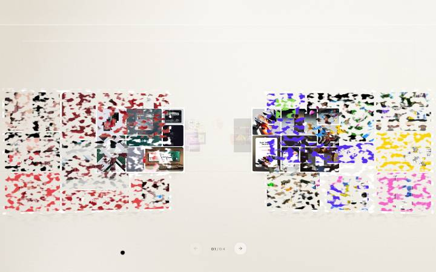

# Homepage refinement verification — 29 October 2026

Review branch: `codex/services-world-phase1-20261019`.
Starting commit: `978e9e8ba9c96adae155cc5117fdd7b85e84d158`.
Application verification commit: `b588f919e2621ca582ea1267e9aef8cdabc71798`.
[Immutable application preview](https://lionovartnext-4m9c912ps-lionovart.vercel.app/).
This evidence commit adds documentation and screenshots only. Production was not merged or promoted.

## Delivered behavior

- Complete trust blocks swap between hero and below-film slots with keyboard-accessible buttons, reserved heights and browser-session persistence.
- Initial CTA uses a white hover/focus treatment. Expanded and offscreen states dispose the liquid-metal instance. Desktop ROAR retains its pointer response and a clockwise resting tilt; touch/mobile uses flat text without mounting the desktop renderer.
- Film occupies the upper reading area. Trust and “To lead…” have separate rows beneath it. The film’s initial position is projected below the full hero, including short-screen overflow.
- Rear service cards rise through the existing continuous orbit. A title-area button toggles real Clash Display weights 400/700 across categories.
- Gallery title approaches during the introductory handoff and clears before rows. Eight projects retain four rows, tags and a central lane. Cards get a longer enlarged hold, reversible granular SVG erosion, coordinated frame/tag retirement and lateral mobile previews.
- Existing project navigation, disabled industry/style dock, partnership ending and normal-flow About remain in place.

## Automated checks

- 165 tests pass: `node --experimental-strip-types --test scripts/*.test.mjs scripts/hero-roar/roar.test.mjs`.
- Next.js 16.3.8 production build and `tsc --noEmit` pass on Vercel.
- Changed components pass ESLint; whitespace checks pass.
- Full repository lint reports **65 errors / 195 warnings**. A checkout of the starting commit produces exactly the same totals. These existing findings are outside this change.

## Actual browser checks

Headless Chromium with Playwright, including touch emulation:

| Check | Result |
| --- | --- |
| 1440×900, 768×1024, 390×844, 320×568, 844×393 | No horizontal overflow |
| Complete hero clearance at all five sizes | Film begins below trust; no initial overlap |
| Trust swapping, keyboard activation, reload | Both slots update; session choice survives reload; height stays reserved |
| Regular / bold service titles | Computed weights 400 / 700 |
| Rapid service category selection | One final selected option and one settled title |
| CTA expansion / closing repeated three times | Expanded canvas count 0; restored count 1; focus restored |
| Leaving / returning to hero | CTA shader count 0 / 1 |
| Gallery forward / reverse | Erosion threshold reverses; restored artwork becomes interactive again |
| Rapid arrows interrupted by native wheel | Pending navigation clears |
| Resize / touch orientation | No horizontal overflow |
| Reduced motion | Static gallery; no CTA or mobile ROAR shader |
| Data saver / simulated two-core device | Lightweight gallery exit |
| Aborted video requests | No browser page errors; poster-based media remains available |
| Responsive/preference scenarios | No browser page errors |

## Visual evidence

Screenshots capture a 1440×900 CSS viewport at half device-pixel resolution. Services shows the bold experiment. Gallery exit shows the scroll-driven erosion mid-transition.

## Verification limits

These are browser-emulation results, not tests on physical phones. Safari/WebKit, Firefox, exhaustive locale coverage and physical-device frame-rate profiling remain pending. No long-session heap/leak certification was performed; the observed bounded checks cover repeated CTA disposal/recreation, offscreen shader removal and gallery media eligibility. Repository-wide lint remains blocked by the unchanged baseline findings.
