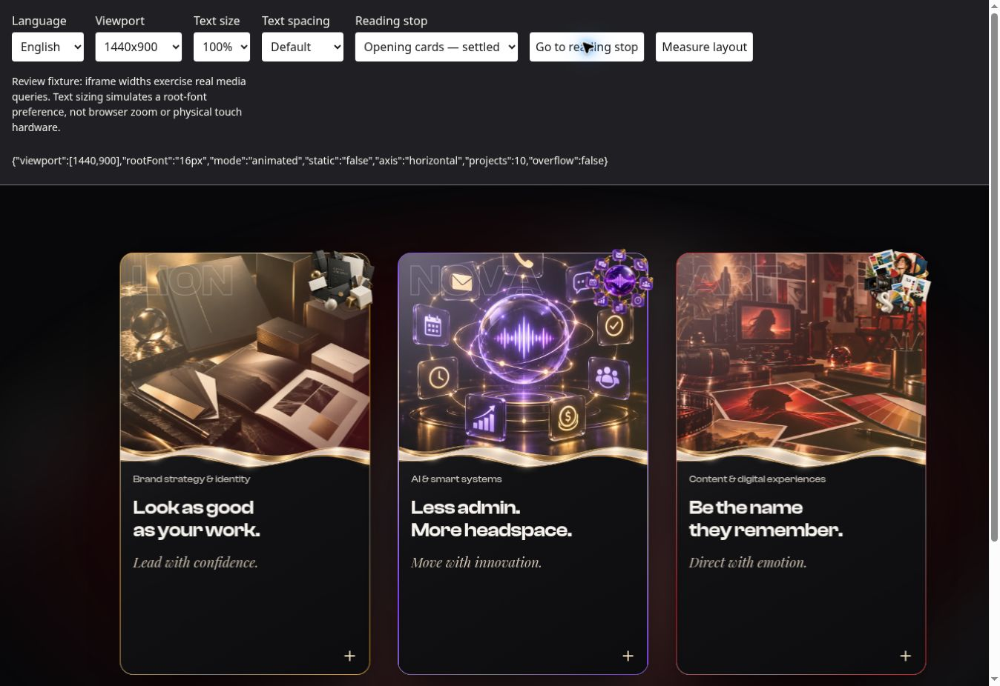
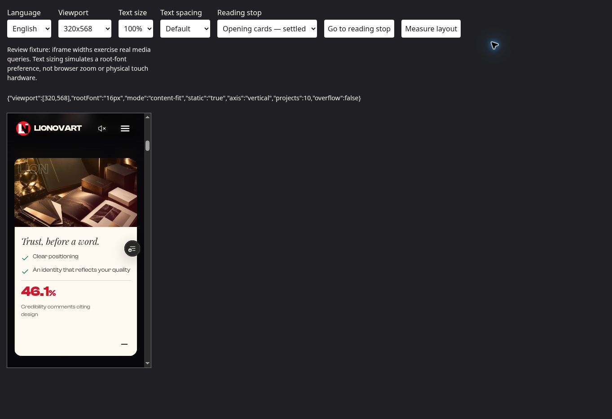

# Phase 1 — responsive composition checkpoint

Review branch: `codex/services-world-phase1-20261019`. Phase 2 has not started. No merge or production promotion.

Final runtime: `40424ca00a994ef9c9d24266a0eb9d1d1b4b0d48`.
Preview (Vercel READY, preview target): https://lionovartnext-cstlfiath-lionovart.vercel.app/qa/story-responsive.html

## Changes and preserved work

The branch already implemented the landscape opening, vertical gallery through 1024 CSS px, horizontal desktop pairs, symmetric compact service triptych, fixed 16:9 center frame, wider captions and presentation-only Motion-tag removal. These were inspected and retained.

The remaining opening bug appeared when shared content-fit selected normal document flow: the old pinned opening height and absolute surfaces left a blank scroll runway. `HeroOpening` now releases its runway and keeps its hero and work layers visible and interactive in the shared fallback. `WhatWeDo` presents the existing source-aspect film with native controls, followed by the same three benefit cards. Card height follows both cover and detail content. No new artwork, animation engine or gesture logic was introduced.

French at 200% root text plus expanded spacing exposed a grid min-content overflow in the first candidate. The final correction gives the detail well a shrinkable column and permits emergency word wrapping. Both faces reserve natural height; text is neither truncated nor shrunk to fit. Flow-card margins no longer inherit the older stacked-card spacing.

The QA fixture now has language and opening-card stops. Hero navigation uses the stable document origin even while its parent is sticky. After resizing or changing language, allow the responsive measurement to settle before selecting a reading stop; the fixture's measurement button reads current state.

## Verification

- 191 Node tests passed: `node --test scripts/*.test.mjs scripts/hero-roar/*.test.mjs scripts/pearl-gold/*.test.mjs`. This includes 16 nested tests beyond the earlier 175-test command.
- TypeScript and scoped ESLint passed for the changed components.
- Final production build passed with `.next-phase1`; generated tsconfig edits were restored.
- `git diff --check` passed.

The following are actual Chromium iframe dimensions, not physical-device emulation or browser zoom. At default text size, every one of the ten project captions had at most two tag rows and tag text was 12px (0.75rem). No sampled document had horizontal overflow. See `measurements.json` for individual caption counts and geometry.

| Locale | Viewport | Text / spacing | Result |
| --- | --- | --- | --- |
| EN | 320×568 | 100%, default | Content-fit reading flow; all ten captions at most two rows; pointer reveal opens the first benefit |
| EN | 390×844 | 100%, default | Animated vertical pair; centered X and identity Y rotation; next arrow reaches pair 02/05 |
| EN | 768×1024 | 100%, default | Animated vertical pair; equal X centers and equal artwork dimensions |
| EN | 1024×768 | 100%, default | Vertical gallery |
| EN | 1025×768 | 100%, default | Horizontal gallery, equal/opposite X positions and equal Y |
| EN | 1440×900 | 100%, default | Landscape opening; symmetric service triptych; center frame stable across Brand, Digital and Spaces |
| FR | 390×844 | 100%, default | Animated vertical pair; all ten captions at most two rows |
| FR | 844×390 | 100%, default | Height fallback; native landscape film uses 16:9; all captions at most two rows |
| FR | 320×568 | 200%, expanded | Natural reading flow; all three benefit details open with keyboard; content and scroll dimensions match; tags may wrap to four rows |

At the French stress setting the three detail regions measured 240px wide and approximately 1058/1034/968px tall, with matching scroll dimensions. The opening and stage were both 6237.72px tall, and the next statement began exactly at their bottom: no leftover pinned runway. Long panels are read by ordinary page scrolling.

At 1440×900 the center service media measured 572.80×322.20px (16:9) for Brand, Digital and Spaces. Rear transforms were ±359.418px X, −42.12px Y and −180px Z, consuming the shared 52%/−12%/−180px variables. Source inspection confirms the same variables feed resting, orbit, gather and release consumers, with 46%/−10%/−130px on mobile.

## Interaction checks and limits

On candidate `470344c4d6ea4227ec346eeef8c20788f607fb66`, the unchanged animated path passed a 1440px early-entry center click, a click four pixels inside the left edge, and keyboard reversal during closing. The final change after this candidate is limited to flow-card CSS. The first card became open with its detail region exposed; keyboard interaction completed immediately. At 390px the original paw reveal opened successfully. At final runtime the 320px normal-flow pointer reveal and all three French enlarged-text keyboard reveals passed.

The retained pointer capture/freeze logic, early activation gates and outgoing-face retirement rules were inspected in source. This is not a physical-touch, continuous pointer-tracking or frame-by-frame transition certification. Those checks, reduced-motion OS testing and cross-browser/hardware acceptance remain in integrated Phase 5 QA. Source/math tests cover gallery approach/exit symmetry; runtime checks above cover reading stops and next-pair navigation.

The cloud browser still reports the pre-existing unavailable WebGL context and null-renderer error recorded in Phase 0. This checkpoint does not claim GPU rendering is verified. Existing gallery taxonomy labels remain partly English on the French route. No translation or GPU subsystem rewrite was included.

## Evidence

The screenshots and measurements are from the final runtime above. The evidence commit is documentation-only and may produce another preview; the linked preview is the exact tested runtime.
